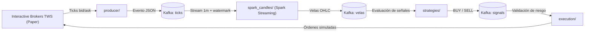

# forex-streaming-trader

Pipeline de trading algorítmico en tiempo real para el mercado FOREX (`EURUSD` / `GBPUSD`), diseñado bajo una arquitectura orientada a eventos con **Interactive Brokers (Paper Trading)**, **Apache Kafka**, **Spark Structured Streaming** y **Python**.

## Arquitectura del sistema



### Principios de diseño

- **Contratos de datos centralizados ([`common/contracts.py`](common/contracts.py)):** Modelos inmutables (`TickEvent`, `CandleEvent`, `SignalEvent`) con validación estricta de precios, consistencia OHLC, normalización de símbolos y parsing flexible de timestamps UTC (ISO-8601 y epoch en segundos o milisegundos).
- **Configuración desacoplada ([`common/config.py`](common/config.py)):** Parámetros de infraestructura, broker y gestión de riesgo cargados mediante variables de entorno (`.env`).
- **Integración continua ([`.github/workflows/ci.yml`](.github/workflows/ci.yml)):** Ejecución automática de la suite de pruebas en cada `push` y `pull_request` sobre `main`.

## Stack tecnológico

- **Lenguaje:** Python 3.11+
- **Streaming y mensajería:** Apache Kafka, PySpark (Structured Streaming)
- **Broker API:** Interactive Brokers (`ib_async`, cuenta Paper Trading)
- **Calidad y pruebas:** `pytest`, GitHub Actions
- **Infraestructura:** Docker / Docker Compose

## Contratos de eventos (Kafka)

| Tópico | Clave | Estructura JSON |
| :--- | :--- | :--- |
| `ticks` | `symbol` | `{"symbol": "EURUSD", "bid": 1.05412, "ask": 1.05420, "timestamp": "2026-11-23T15:04:05.123456Z"}` |
| `velas` | `symbol` | `{"symbol": "EURUSD", "inicio": "2026-11-23T15:04:00Z", "open": 1.05416, "high": 1.05445, "low": 1.05401, "close": 1.05432, "num_ticks": 48}` |
| `signals` | `symbol` | `{"id_algoritmo": "ema_crossover_5_13", "symbol": "EURUSD", "signal": "BUY", "precio_referencia": 1.05432, "timestamp": "2026-11-23T15:05:00Z"}` |

## Estructura del repositorio

```text
forex-streaming-trader/
├── .github/workflows/ci.yml   # Pipeline de CI con pytest
├── .env.example               # Plantilla de variables de entorno
├── common/
│   ├── config.py              # Configuración centralizada desde entorno
│   └── contracts.py           # Esquemas, validación y serialización JSON
├── producer/                  # Ingesta de ticks (IBKR / simulador)
├── spark_candles/             # Agregación de velas 1m en Spark Streaming
├── strategies/                # Lógica pura de señales algorítmicas
├── backtesting/               # Evaluación histórica de estrategias
├── execution/                 # Controles de riesgo y envío de órdenes
├── infra/                     # Definición de servicios locales (Kafka)
├── data/                      # Datos históricos locales (ignorados en Git)
├── tests/
│   └── test_contracts.py      # Pruebas unitarias de contratos y validación
├── pytest.ini
└── requirements.txt
```

## Instalación y pruebas locales

1. Clona el repositorio y crea un entorno virtual de Python:

```bash
python -m venv .venv
# Windows (PowerShell): .\.venv\Scripts\Activate.ps1
# Linux / macOS:        source .venv/bin/activate
```

2. Instala las dependencias:

```bash
pip install -r requirements.txt
```

3. Configura tus variables de entorno locales a partir de la plantilla:

```bash
cp .env.example .env
```

4. Ejecuta las pruebas unitarias:

```bash
pytest -v
```
