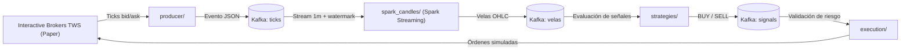

# forex-streaming-trader

Pipeline de trading algorítmico en tiempo real para el mercado FOREX (`EURUSD` / `GBPUSD`), diseñado bajo una arquitectura orientada a eventos con **Interactive Brokers (Paper Trading)**, **Apache Kafka**, **Spark Structured Streaming** y **Python**.

## Arquitectura del sistema



### Principios de diseño

- **Contratos de datos centralizados ([`common/contracts.py`](common/contracts.py)):** Modelos inmutables (`TickEvent`, `CandleEvent`, `SignalEvent`) con validación estricta de precios, consistencia OHLC, normalización de símbolos y parsing flexible de timestamps UTC (ISO-8601 y epoch en segundos o milisegundos).
- **Configuración desacoplada ([`common/config.py`](common/config.py)):** Parámetros de infraestructura, broker y gestión de riesgo cargados mediante variables de entorno (`.env`).
- **Integración continua ([`.github/workflows/ci.yml`](.github/workflows/ci.yml)):** Ejecución automática de la suite de pruebas en cada `push` y `pull_request` sobre `main`.

## Stack tecnológico

- **Lenguaje:** Python 3.11+
- **Streaming y mensajería:** Apache Kafka, PySpark (Structured Streaming)
- **Broker API:** Interactive Brokers (`ib_async`, cuenta Paper Trading)
- **Calidad y pruebas:** `pytest`, GitHub Actions
- **Infraestructura:** Docker / Docker Compose

## Contratos de eventos (Kafka)

| Tópico | Clave | Estructura JSON |
| :--- | :--- | :--- |
| `ticks` | `symbol` | `{"symbol": "EURUSD", "bid": 1.05412, "ask": 1.05420, "timestamp": "2026-11-23T15:04:05.123456Z"}` |
| `velas` | `symbol` | `{"symbol": "EURUSD", "inicio": "2026-11-23T15:04:00Z", "open": 1.05416, "high": 1.05445, "low": 1.05401, "close": 1.05432, "num_ticks": 48}` |
| `signals` | `symbol` | `{"id_algoritmo": "ema_crossover_5_13", "symbol": "EURUSD", "signal": "BUY", "precio_referencia": 1.05432, "timestamp": "2026-11-23T15:05:00Z"}` |

## Estructura del repositorio

```text
forex-streaming-trader/
├── .github/workflows/ci.yml   # Pipeline de CI con pytest
├── .env.example               # Plantilla de variables de entorno
├── common/
│   ├── config.py              # Configuración centralizada desde entorno
│   └── contracts.py           # Esquemas, validación y serialización JSON
├── infra/
│   └── docker-compose.yml     # Kafka KRaft, creación de tópicos, Kafka UI y Spark Streaming
├── producer/
│   ├── kafka_publisher.py     # Publicador validado hacia el tópico ticks
│   ├── ib_producer.py         # Productor en vivo conectado a IBKR TWS Paper
│   └── mock_producer.py       # Simulador 24/7 de ticks FOREX
├── spark_candles/
│   └── candles_job.py         # Job Spark Structured Streaming (ticks -> velas 1m)
├── strategies/
│   ├── base.py                # Interfaz BaseStrategy compartida con backtesting
│   ├── ema_crossover.py       # Estrategia de cruce EMA rápida/lenta (5/13)
│   ├── rsi_reversion.py       # Estrategia de reversión RSI de Wilder (14)
│   ├── registry.py            # Fábrica de estrategias
│   └── runner.py              # Consumidor Kafka de velas y publicador de signals
├── execution/
│   ├── risk.py                # Motor de 5 controles de riesgo pre-trade
│   ├── ib_client.py           # Cliente IBKR Paper-only (puerto 7497/4002 y cuenta DU*)
│   └── executor.py            # Consumidor de signals con auditoría JSONL
├── backtesting/
│   ├── download_history.py    # Descarga histórica desde IBKR o generación sintética CSV
│   ├── engine.py              # Simulador con spread y cálculo de métricas
│   └── run_backtest.py        # Comparador CLI de estrategias
├── data/                      # Datos locales, resultados y logs de auditoría (ignorados en Git)
├── tests/                     # Pruebas unitarias y de interoperabilidad
├── pytest.ini
└── requirements.txt
```

## Instalación y pruebas locales

1. Clona el repositorio y activa tu entorno de Python 3.11+ (`conda` o `venv`):

```bash
python -m venv .venv
# Windows (PowerShell): .\.venv\Scripts\Activate.ps1
# Linux / macOS:        source .venv/bin/activate
```

2. Instala las dependencias:

```bash
pip install -r requirements.txt
```

3. Crea tu archivo `.env` a partir de la plantilla:

```bash
cp .env.example .env
```

4. Ejecuta la suite de pruebas:

```bash
pytest -v
```

## Ejecución del pipeline End-to-End (E2E)

1. **Infraestructura (Kafka KRaft, Kafka UI en `http://localhost:8080` y Spark Streaming):**

```bash
docker compose -f infra/docker-compose.yml up -d
docker compose -f infra/docker-compose.yml logs -f spark-candles
```

2. **Estrategias en paralelo (una terminal por algoritmo):**

```bash
python -m strategies.runner --strategy ema
python -m strategies.runner --strategy rsi
```

3. **Servicio de riesgo y ejecución:**

```bash
# Modo simulación sin enviar órdenes a TWS:
python -m execution.executor --dry-run

# Modo Paper Trading real (requiere TWS Paper abierto en 127.0.0.1:7497):
python -m execution.executor
```

4. **Productor de ticks:**

```bash
# Simulador 24/7 para pruebas locales:
python -m producer.mock_producer --interval 0.5

# Cotizaciones en vivo desde IBKR TWS Paper:
python -m producer.ib_producer
```

> Al finalizar, apaga los contenedores con `docker compose -f infra/docker-compose.yml down`.

## Backtesting histórico

Genera velas sintéticas (o descarga datos históricos reales desde TWS con `--duration "5 D"`) y compara las estrategias:

```bash
python -m backtesting.download_history --symbol EURUSD --synthetic --bars 3000
python -m backtesting.run_backtest --csv data/EURUSD_1m.csv
```

Resultados de referencia sobre 3,000 velas sintéticas de `EURUSD` (`spread=0.8 pips`, `10,000` unidades):

| Algoritmo | Trades | Win % | PnL (USD) | Retorno % | Profit Factor | Max Drawdown % | Sharpe |
| :--- | ---: | ---: | ---: | ---: | ---: | ---: | ---: |
| `ema_crossover_5_13` | 139 | 34.53% | 1,942.81 | 1.943% | 4.10 | 0.080% | 107.19 |
| `rsi_reversion_14` | 18 | 11.11% | -1,912.21 | -1.912% | 0.02 | 1.918% | -107.06 |

## Interoperabilidad entre equipos

- **Correr nuestras estrategias sobre el Kafka de otro equipo:** cambia únicamente `KAFKA_BOOTSTRAP_SERVERS=<IP_OTRO_EQUIPO>:9092` en `.env` y ejecuta `python -m strategies.runner --strategy ema` (o `rsi`).
- **Recibir algoritmos de otro equipo en nuestra plataforma:** comparte tu broker (`PLAINTEXT_HOST://<TU_IP>:9092` en `infra/docker-compose.yml`). Cualquier algoritmo que publique en `signals` respetando `{id_algoritmo, symbol, signal, precio_referencia, timestamp}` será evaluado automáticamente por `execution/executor.py` bajo nuestros controles de riesgo.
